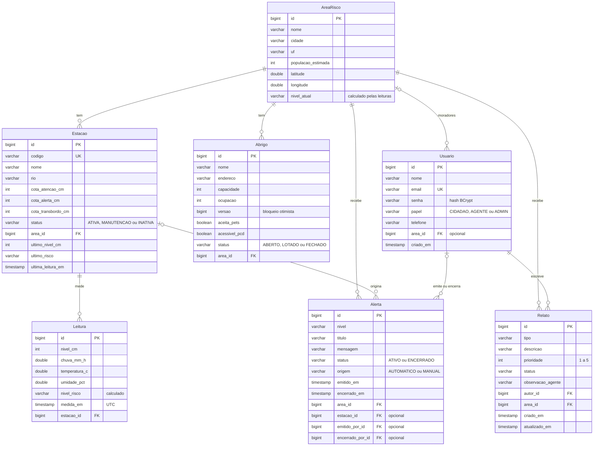

# GuardaRio API

API REST do GuardaRio, um sistema de alerta comunitário de enchentes. Estações IoT medem o nível do rio e a chuva, a API classifica o risco, abre alertas automáticos para o bairro, mostra os abrigos com vaga e recebe relatos dos moradores com prioridade calculada para a Defesa Civil.

Global Solution 2026/2 (tema CitizenTech), disciplina Java Advanced, FIAP. Esta é a API consumida pelo app Flutter da disciplina de Mobile.

## Integrantes

| Nome | RM |
|---|---|
| Henrique Spoltore Moreno Pavão dos Santos | RM568130 |
| Raphael Oliveira Sinelli Mendonça | RM568346 |
| Arthur Lins Belarmino | RM566845 |

## Vídeo pitch

Link: **(colocar aqui o link do YouTube antes da entrega)**

## O problema

Nas enchentes de 2024 no Rio Grande do Sul, 478 dos 497 municípios foram atingidos e mais de 2,39 milhões de pessoas foram afetadas (boletins da Defesa Civil do RS). Segundo o IBGE e o Cemaden, 8,27 milhões de brasileiros moram em áreas de risco de enchente e deslizamento.

O alerta oficial cobre a cidade ou a bacia inteira. Quem mora na rua mais baixa não sabe se a água vai chegar na casa dele, nem quando. Na hora da cheia ninguém sabe qual abrigo ainda tem vaga ou aceita animais, e os pedidos de socorro chegam por grupos de WhatsApp, sem ordem de prioridade.

O GuardaRio mede o rio no ponto que afeta cada bairro e transforma a medição em aviso, em informação de abrigo e em fila de atendimento. Atende os ODS 11 (meta 11.5, reduzir pessoas afetadas por desastres), 13 (meta 13.3, alerta precoce), 3 e 10.

## Como rodar

Requisito: **JDK 17 ou mais novo** (testado com o 17 e o 21). Não precisa instalar Maven, porque o projeto traz o Maven Wrapper, nem banco de dados, porque o perfil padrão usa H2 em memória.

```bash
git clone https://github.com/Raphael-Sinelli/guardario-api.git
cd guardario-api

./mvnw spring-boot:run        # Linux, macOS ou Git Bash
.\mvnw.cmd spring-boot:run    # Windows (PowerShell ou CMD)
```

A API sobe em `http://localhost:8080` já com dados de demonstração (4 áreas, 4 estações com histórico de leituras, 5 abrigos, 5 relatos e 1 alerta automático ativo em Sarandi).

| O quê | Endereço |
|---|---|
| Swagger UI | http://localhost:8080/swagger-ui.html |
| OpenAPI (JSON) | http://localhost:8080/v3/api-docs |
| Health | http://localhost:8080/actuator/health |
| Console do H2 | http://localhost:8080/h2-console (JDBC URL `jdbc:h2:mem:guardario`, usuário `sa`, senha em branco) |

Se o wrapper reclamar da versão do Java, confira se `java -version` e a variável `JAVA_HOME` apontam para um JDK 17 ou mais novo. No Linux ou macOS, se aparecer `Permission denied`, rode `chmod +x mvnw` uma vez.

Outros comandos:

```bash
./mvnw test                                   # roda os 69 testes
./mvnw clean package                          # gera target/guardario-api-1.0.0.jar
java -jar target/guardario-api-1.0.0.jar      # roda o jar gerado
```

### Variáveis de ambiente

Nenhuma é obrigatória no perfil `dev`. O arquivo `.env.example` lista todas; o `.env` real fica fora do Git.

| Variável | Para que serve | Padrão |
|---|---|---|
| `JWT_SECRET` | Chave HS256 do JWT, com 32 caracteres ou mais | sem valor: a API gera uma chave aleatória a cada subida |
| `CORS_ALLOWED_ORIGINS` | Origens liberadas para o app | `http://localhost:*`, `http://127.0.0.1:*`, `http://10.0.2.2:*` |
| `SPRING_PROFILES_ACTIVE` | `dev` (H2) ou `prod` (PostgreSQL) | `dev` |
| `DB_URL`, `DB_USERNAME`, `DB_PASSWORD` | Banco do perfil `prod` | `DB_PASSWORD` não tem padrão |
| `SEED_ENABLED` | Carga de dados de demonstração | `true` no dev, `false` no prod |
| `ADMIN_EMAIL`, `ADMIN_PASSWORD` | Primeiro ADMIN do perfil `prod`, criado na subida pelo `AdminInitializer` se o email ainda não existir (senha de 8 a 72 caracteres) | sem valor: nenhum ADMIN é criado |
| `PORT` | Porta HTTP | `8080` |

## Usuários de teste por papel

Criados pela carga de demonstração do perfil `dev`. No perfil `prod` eles não existem: o primeiro ADMIN vem de `ADMIN_EMAIL` e `ADMIN_PASSWORD`, e é ele quem promove os agentes.

| Papel | Email | Senha | O que pode fazer |
|---|---|---|---|
| ADMIN | admin@guardario.com | Admin@123 | Tudo: cadastrar áreas e estações, excluir registros, promover usuários a AGENTE, ver métricas |
| AGENTE | agente@guardario.com | Agente@123 | Registrar leituras, emitir, editar e encerrar alertas, gerenciar abrigos, atender relatos |
| CIDADAO | cidadao@guardario.com | Cidadao@123 | Enviar, editar e excluir os próprios relatos |
| CIDADAO | maria@guardario.com | Maria@123 | Segunda moradora, para testar que um cidadão não vê o relato do outro |

Sem login dá para consultar áreas, estações, leituras, alertas e abrigos. Informação de segurança não pode depender de conta.

### Testando pelo Swagger

1. Em `POST /api/auth/login`, faça login com um dos usuários acima.
2. Copie o `token` da resposta, clique em **Authorize** e cole só o token, sem a palavra `Bearer`.
3. Roteiro que passa pelo fluxo principal:
   1. Logado como agente, `POST /api/estacoes/1/leituras` com `{"nivelCm": 310, "chuvaMmH": 20}`. A estação GR-SP-001 tem cota de transbordo de 300 cm, então a resposta vem com `nivelRisco: EMERGENCIA` e um `alertaGeradoId`.
   2. `GET /api/alertas/ativos`: o alerta de emergência do Jardim Pantanal aparece em primeiro.
   3. `GET /api/abrigos?areaId=1&aceitaPets=true&comVagas=true`: abrigos do bairro que aceitam animais e têm vaga.
   4. Logado como cidadão, `POST /api/relatos` com `{"tipo": "BUEIRO_ENTUPIDO", "descricao": "Bueiro entupido na Rua Capachós", "areaId": 1}`. A prioridade vem 3: base 2 do tipo, mais 1 porque a área está em emergência.
   5. Logado como agente, `GET /api/relatos` lista o painel com a maior prioridade primeiro. `PATCH /api/relatos/{id}/status` com `{"status": "EM_ATENDIMENTO"}` muda o status, e os links da resposta trocam `atender` por `resolver`.

### Testando com o Postman (ou o Bruno)

A pasta `postman/` tem a coleção `GuardaRio.postman_collection.json`, com 89 requisições em 10 pastas e testes automáticos em cada uma (status esperado e regras de negócio). O Bruno importa o mesmo arquivo.

1. Suba a API e importe o arquivo no Postman.
2. Rode a pasta **01 Autenticação**: os logins guardam os tokens nas variáveis da coleção, e as outras requisições já usam o token certo para cada papel.
3. Rode a pasta **02 Fluxo principal**, que é o roteiro da demonstração, ou a coleção inteira pelo Runner.

A coleção conta com os dados de uma API recém-iniciada. Para rodar tudo de novo do zero, reinicie a API.

## Regras de negócio

| ID | Regra | Onde está no código |
|---|---|---|
| RN01 | O risco da leitura segue a régua da estação (cotas de atenção, alerta e transbordo) e sobe um nível com chuva de 50 mm/h ou mais | `Estacao.classificar`, `NivelRisco.elevar` |
| RN02 | Leitura em ALERTA ou pior abre alerta automático para a área, se ela ainda não tiver alerta ativo de nível igual ou maior. Alertas ativos de nível menor são substituídos | `AlertaServiceImpl.gerarAutomatico` |
| RN03 | O nível da área é o maior risco entre as últimas leituras das suas estações ATIVAS. É recalculado a cada leitura e quando uma estação muda de área, muda de status ou é excluída | `AreaRisco.recalcularNivel`, `EstacaoServiceImpl.atualizar` e `excluir` |
| RN04 | Só AGENTE ou ADMIN encerra alerta, e alerta encerrado não reabre (409) | `@PreAuthorize` no `AlertaController`, `Alerta.encerrar` |
| RN05 | A ocupação do abrigo nunca passa da capacidade. Cheio vira LOTADO, com vaga volta a ABERTO, FECHADO não recebe ninguém | `Abrigo.registrarEntrada`, `registrarSaida`, `atualizarStatus`; `@OcupacaoDentroDaCapacidade` |
| RN06 | Prioridade do relato de 1 a 5: base do tipo (pessoa ilhada 5, deslizamento 4, rio subindo e alagamento 3, bueiro 2, outro 1), mais 1 se a área estiver em ALERTA ou EMERGENCIA | `TipoRelato`, `Relato.definirPrioridade` |
| RN07 | Status do relato: ABERTO vai para EM_ATENDIMENTO ou DESCARTADO; EM_ATENDIMENTO vai para RESOLVIDO. Transição inválida dá 409 | `StatusRelato.podeMudarPara`, `Relato.alterarStatus` |
| RN08 | O cadastro público sempre cria CIDADAO; só o ADMIN promove alguém | `AuthServiceImpl.registrar`, `UsuarioController` |
| RN09 | O cidadão vê e edita só os próprios relatos, e só exclui enquanto estão ABERTO | `RelatoServiceImpl` |
| RN10 | As cotas da estação precisam ser crescentes: atenção < alerta < transbordo | `@CotasCrescentes` |

Outras regras: estação em MANUTENCAO ou INATIVA não recebe leitura (409); leitura atrasada (mais antiga que a última da estação) ou medida há mais de 1 hora entra no histórico, mas não muda o nível atual nem gera alerta, porque o alerta precisa descrever o rio de agora; estação com alerta no histórico não pode ser excluída, só desativada; área com estações, abrigos, alertas ou relatos não pode ser excluída; o ADMIN não pode alterar o próprio papel; no PUT, abrigo sem `ocupacao` mantém as pessoas que já estão lá (e a capacidade não pode ficar abaixo delas, 409) e estação sem `status` mantém o status atual.

## Diagrama das entidades



## Modelagem: relacionamentos, cascade e fetch

| Relação | Lado dono (FK) | cascade | orphanRemoval | Motivo |
|---|---|---|---|---|
| Estacao 1:N Leitura (bidirecional) | `leitura.estacao_id` | ALL | true | Leitura não existe sem a estação. Excluir a estação apaga o histórico junto |
| AreaRisco 1:N Estacao (bidirecional) | `estacao.area_id` | nenhum | não | A estação tem vida própria. Apagar uma área não pode levar estações embora; a exclusão é barrada com 409 |
| AreaRisco 1:N Abrigo, Alerta e Relato | FK no lado N | nenhum | não se aplica | Mapeadas só com `@ManyToOne`: ninguém precisa navegar da área para a lista de relatos |
| Usuario N:1 AreaRisco | `usuario.area_id` (opcional) | nenhum | não se aplica | Bairro onde a pessoa mora |
| Relato N:1 Usuario | `relato.autor_id` | nenhum | não se aplica | O autor vem do token |
| Alerta N:1 Estacao e Usuario | `estacao_id`, `emitido_por_id`, `encerrado_por_id` (opcionais) | nenhum | não se aplica | Alerta manual pode não ter estação; alerta automático não tem emissor humano |

**Fetch.** Todas as associações têm `fetch = FetchType.LAZY` escrito, inclusive os `@ManyToOne`, cujo padrão é EAGER. Listar alertas não precisa carregar estação e usuário de cada um. Quando a resposta precisa de um dado do pai, a consulta busca junto de forma pontual: `@EntityGraph(attributePaths = "area")` em `EstacaoRepository` e `AlertaRepository` (as respostas mostram o nome da área) e `join fetch` em `EstacaoRepository.buscarCriticas`. Assim a listagem faz um SELECT só, sem o problema N+1.

**DTOs.** O controller nunca recebe nem devolve entidade. Os records de resposta levam só o id do pai (`areaId`, `estacaoId`, `autorId`), o que evita ciclo na serialização e não expõe o hash da senha. `spring.jpa.open-in-view` está desligado, então todo mapeamento para DTO acontece dentro do `@Transactional` do service.

**Outros detalhes.** Enums gravados como texto (`EnumType.STRING`), datas em `Instant` (UTC) e índice em `leitura(estacao_id, medida_em)`, que é a busca do histórico. O `Abrigo` tem `@Version` (bloqueio otimista): durante a cheia vários agentes registram entradas no mesmo abrigo ao mesmo tempo, e sem a versão o segundo UPDATE sobrescreveria o primeiro, perdendo uma entrada já confirmada. Com ela, a requisição que perde a corrida recebe 409 e tenta de novo.

## Consultas: por que cada tipo

**Derived query** quando a consulta tem uma ou duas condições simples. O nome do método já documenta o que ele faz, e o Spring valida o nome na subida da aplicação.

| Método | Uso |
|---|---|
| `UsuarioRepository.findByEmail`, `existsByEmail` | Login, filtro JWT e cadastro sem email repetido |
| `RelatoRepository.findByAutorId(id, pageable)` | `GET /api/relatos/meus` |
| `LeituraRepository.findByEstacaoId(id, pageable)` | Histórico de leituras da estação |
| `LeituraRepository.findByIdAndEstacaoId` | `GET /api/estacoes/{id}/leituras/{leituraId}`: a leitura só aparece pela URL da estação dona dela |
| `AreaRiscoRepository.findByUfIgnoreCase` | Filtro por estado em `GET /api/areas?uf=RS` |
| `EstacaoRepository.findByAreaId` (com `@EntityGraph`) | Estações de uma área |
| `AlertaRepository.findByStatus`, `findByAreaIdAndStatus` | Lista por status e verificação da RN02 |
| `AbrigoRepository.findByStatusOrderByNomeAsc` | Abrigos disponíveis |
| `existsByAreaId`, `existsByEstacaoId`, `existsByCodigoIgnoreCase` | Bloquear exclusão com vínculo e código duplicado |

**JPQL com `@Query`** quando o derived não alcança: agregação, junção com condição, projeção em record e ordenação por conta entre colunas.

| Consulta | Rota | O que o JPQL faz |
|---|---|---|
| `AreaRiscoRepository.rankingPorRelatosEmAberto` | `GET /api/areas/ranking` | `left join Relato r on ... and r.status in (...)` para a área sem relato também aparecer, `group by`, `count`, `max`, `coalesce` e `select new RankingAreaResponse(...)` |
| `EstacaoRepository.buscarCriticas` | `GET /api/estacoes/criticas` | só estações ATIVAS, `join fetch e.area` (sem N+1) e `order by (e.ultimoNivelCm - e.cotaTransbordoCm) desc`, da estação mais perto do transbordo para a mais longe |
| `LeituraRepository.estatisticas` | `GET /api/estacoes/{id}/leituras/estatisticas` | `count`, `avg`, `min` e `max` calculados no banco e projetados num record, sem trazer as leituras para a memória |

**Specification** nos filtros de tela, em que todos os parâmetros são opcionais e combináveis. Com derived query, um filtro nulo vira `is null`, e cada combinação pediria um método novo: com os 6 filtros de relato seriam 64 métodos. Cada filtro é um método pequeno em `RelatoSpecification` ou `AbrigoSpecification` e só entra no WHERE se o parâmetro veio preenchido.

| Specification | Rota | Filtros |
|---|---|---|
| `RelatoSpecification.comFiltros` | `GET /api/relatos` | tipo, status, área, prioridade mínima, criado a partir de, criado até |
| `AbrigoSpecification.comFiltros` | `GET /api/abrigos` | área, aceita pets, acessível para PcD, com vagas (compara as colunas `ocupacao < capacidade`; `comVagas=false` traz os lotados ou fechados), status |

**Paginação e ordenação.** As listas recebem `Pageable` do Spring Data (`?page=0&size=10&sort=nome,asc`) com padrão definido em `@PageableDefault` e no máximo 100 itens por página. Campo de ordenação que não existe devolve 400. O painel de relatos ordena por padrão pela maior prioridade e, no empate, pelo mais antigo.

## Cache

Spring Cache com o Caffeine como provedor. O cache guarda DTOs (records), nunca entidades: entidade fora da transação causaria `LazyInitializationException`.

Quem mantém o cache correto é o `@CacheEvict` nas escritas. A configuração `maximumSize=500,expireAfterWrite=10m,recordStats` acrescenta duas coisas: um teto de memória e um prazo de 10 minutos como rede de segurança, caso alguma escrita fora da API mude o banco; e as estatísticas de acerto e erro que aparecem no Actuator.

| Cache | O que guarda | Quando é limpo | Por que cachear |
|---|---|---|---|
| `alertasAtivos` | `AlertaServiceImpl.ativos()`, usado por `GET /api/alertas/ativos` | `@CacheEvict(allEntries = true)` ao emitir, editar, encerrar ou excluir alerta. No alerta automático, só quando um alerta nasce de fato (`condition = "#result != null"`). Também ao atualizar uma área, porque cada alerta guardado leva o nome dela | É a consulta que o app faz toda vez que abre, e só muda quando um alerta muda |
| `abrigosDisponiveis` | `AbrigoServiceImpl.disponiveis()`, usado por `GET /api/abrigos/disponiveis` | Em toda escrita de abrigo: criar, atualizar, abrir ou fechar, entrada, saída e exclusão | Durante a cheia muita gente procura vaga ao mesmo tempo |
| `areas` (chave: id) | `AreaServiceImpl.buscarPorId`, usado por `GET /api/areas/{id}` | Ao atualizar ou excluir a área (`key = "#id"`) e no registro de leitura, só quando o nível da área muda (`key = "#result.areaId()"`, `condition = "#result.nivelAreaAlterado()"`) | A tela do bairro mostra o nível de risco. As leituras chegam a cada 10 segundos, mas o nível muda raramente; limpar a cada leitura anularia o cache |

Ficam fora do cache: relatos (têm dado pessoal, são diferentes para cada usuário e mudam o tempo todo), leituras (chegam a cada 10 segundos) e as listas paginadas (combinações demais de página, ordenação e filtro).

Três jeitos de ver o cache funcionando:

1. **Log.** Chame `GET /api/alertas/ativos` duas vezes. Na primeira o console mostra `Cache 'alertasAtivos' vazio: consultando o banco` e o SELECT; na segunda, nada, porque o método nem chega a rodar.
2. **Métricas.** Com o token de ADMIN, `GET /actuator/metrics/cache.gets?tag=cache:alertasAtivos&tag=result:hit` mostra quantas leituras vieram do cache; com `result:miss`, quantas foram ao banco.
3. **Invalidação.** Registre uma leitura que gere alerta e chame os ativos de novo: o log volta a aparecer, porque o `@CacheEvict` limpou o cache.

`GET /actuator/caches` lista os três caches.

Limitação conhecida: o Caffeine guarda o cache na memória de cada instância. Com várias réplicas da API, o próximo passo seria um cache distribuído, como o Redis.

## HATEOAS

As respostas usam o formato HAL. As listas vêm com os itens em `_embedded`, os dados de paginação em `page` e os links de navegação (`first`, `prev`, `self`, `next`, `last`) em `_links`. Cada recurso traz o link `self`, os recursos relacionados e as ações possíveis no estado atual para quem fez a requisição:

| Recurso | Relacionados | Ações (dependem do estado e do papel) |
|---|---|---|
| Alerta | `area`, `estacao`, `abrigos-com-vaga` | ATIVO e usuário AGENTE ou ADMIN: `encerrar`, `editar`. ADMIN: `excluir`. Alerta encerrado não tem ação |
| Relato | `area`, `meus-relatos` | Para AGENTE ou ADMIN: ABERTO tem `atender` e `descartar`; EM_ATENDIMENTO tem `resolver`. Para o autor, enquanto ABERTO: `editar`, `excluir` |
| Abrigo | `area`, `abrigos-disponiveis` | Com vaga: `registrar-entrada`. Com gente: `registrar-saida`. Aberto ou lotado: `fechar`. Fechado: `reabrir` |
| Estação | `area`, `leituras`, `estatisticas-24h` | Estação ATIVA e usuário AGENTE ou ADMIN: `registrar-leitura` |
| Leitura | `estacao`, `estatisticas-24h`. Na resposta do registro: `estacao`, `area` e, quando a leitura abre um alerta automático, `alerta` | nenhuma: leitura não muda depois de gravada |
| Área | `estacoes`, `abrigos-com-vaga`, `alertas-ativos` | ADMIN: `atualizar`, `excluir` |
| Linha do ranking | `area`, `abrigos-com-vaga` | nenhuma: é um relatório |
| Usuário (rotas do ADMIN) | `area`, `usuarios` | `alterar-papel`, menos no registro do próprio ADMIN, que não pode mudar o próprio papel |

Quem não está logado não recebe link de ação. O link orienta o cliente, mas não substitui a checagem: o servidor confere a permissão em toda requisição.

## Actuator

| Endpoint | Acesso | O que mostra |
|---|---|---|
| `/actuator/health` | público; detalhes só para ADMIN | Público: só o status (`UP`). Com o token de ADMIN: banco de dados e disco (`show-details: when-authorized`), que mostram o tipo de banco e o caminho da pasta e não devem ficar abertos |
| `/actuator/info` | público | Nome, descrição e versão da aplicação e dados do build. Versão do Java e do sistema operacional ficam de fora, pelo mesmo motivo |
| `/actuator/metrics` | ADMIN | Métricas da JVM e do HTTP, acertos e erros do cache (`cache.gets`) e a métrica do domínio `guardario.alertas.emitidos`, com as tags `origem` e `nivel` |
| `/actuator/caches` | ADMIN | Os três caches da aplicação |

## Segurança

**Fluxo do JWT, do login à requisição protegida:**

1. `POST /api/auth/register` grava o usuário como CIDADAO, com a senha em hash BCrypt.
2. `POST /api/auth/login` passa pelo `AuthenticationManager`, que busca o usuário pelo `UserDetailsService` e compara a senha com `BCrypt.matches`. Senha errada lança `BadCredentialsException`, que vira 401 com uma mensagem genérica, para não revelar quais emails existem. O cadastro, como no projeto da disciplina, ainda responde 409 para email repetido; esconder isso exigiria confirmar o email por mensagem, o que fica fora do escopo.
3. O `JwtService` gera um token HS256 que vale 1 hora, com o email no `sub` e o papel numa claim informativa.
4. O app manda `Authorization: Bearer <token>` em cada requisição.
5. O `JwtAuthenticationFilter` (um `OncePerRequestFilter`) valida assinatura e expiração, carrega o usuário do banco e coloca no `SecurityContext`. O papel que vale é o do banco: uma promoção feita pelo ADMIN vale na hora, e um papel forjado no token não adianta.
6. O `SecurityConfig` controla as áreas de URL (rotas públicas, `/api/usuarios/**` e `/actuator/**` só para ADMIN), o `@PreAuthorize` de cada método controla a ação, e o service confere a posse (relato de outra pessoa dá 403, sempre depois de verificar se existe: 404 vem antes de 403).

**401 x 403.** Sem token, ou com token inválido ou expirado, o `RestAuthenticationEntryPoint` responde 401. Usuário logado sem permissão recebe 403, do `RestAccessDeniedHandler` (área de URL) ou do `GlobalExceptionHandler` (`@PreAuthorize` e regra de posse). Os dois handlers da cadeia de filtros escrevem o mesmo JSON de erro do resto da API.

**Stateless.** Sem sessão no servidor (`SessionCreationPolicy.STATELESS`) e com o CSRF desligado, porque o token vai no header e não existe cookie de sessão para um site malicioso aproveitar.

**CORS para o app.** O `CorsConfigurationSource` libera as origens de `CORS_ALLOWED_ORIGINS` (o padrão inclui `10.0.2.2`, endereço com que o emulador Android enxerga a máquina), os métodos GET, POST, PUT, PATCH, DELETE e OPTIONS, os headers `Authorization` e `Content-Type`, e expõe o header `Location` para o app ler o id do recurso criado. Origem fora da lista recebe 403 no preflight.

**Segredos.** Nenhuma senha ou chave real está no repositório. A chave do JWT vem de `JWT_SECRET`; sem ela, a API gera uma chave aleatória a cada subida e avisa no log. A senha do PostgreSQL vem de `DB_PASSWORD`, sem valor padrão, e a do primeiro ADMIN de produção vem de `ADMIN_PASSWORD`. As senhas da tabela de usuários de teste existem só na carga do perfil `dev`.

## Validação e tratamento de erros

Bean Validation nos records de entrada (`@NotBlank`, `@Size`, `@Email`, `@Pattern`, `@Positive`, `@PastOrPresent`, `@DecimalMin` e outras) e quatro constraints próprias: duas de classe, porque comparam campos entre si (`@CotasCrescentes` na estação e `@OcupacaoDentroDaCapacidade` no abrigo), e duas de campo: `@TamanhoEmBytes(max = 72)` na senha, porque o BCrypt só considera 72 bytes e letra com acento ocupa 2, e `@NivelDeAlerta`, que recusa alerta manual com nível NORMAL. A UF precisa ser a sigla de um estado, o telefone tem só dígitos com DDD, o email precisa de domínio com ponto e número decimal em campo inteiro dá 400 (o Jackson arredondaria em silêncio). Os records de relato, login e cadastro tiram os espaços em volta do texto no construtor compacto, antes da validação. Os controllers têm `@Validated`, o que faz valer `@Positive` e `@Max` nos parâmetros de rota e de query.

O `GlobalExceptionHandler` (`@RestControllerAdvice`) padroniza todas as respostas de erro: `error` é sempre o nome do status HTTP e `message` explica o problema em português. Erro de campo lista todos os campos em `errors`, inclusive os erros de classe e os valores que nem chegam a ser lidos, como um enum que não existe ou texto no lugar de número:

```json
{
  "timestamp": "2026-11-18T14:30:00Z",
  "status": 400,
  "error": "Bad Request",
  "message": "Dados inválidos: confira os campos em errors",
  "path": "/api/estacoes",
  "errors": [
    { "field": "nome", "message": "não deve estar em branco" },
    { "field": "estacaoRequest", "message": "As cotas precisam ser crescentes: atenção < alerta < transbordo" }
  ]
}
```

Os demais erros seguem o formato `ErrorCustomResponse`:

```json
{
  "timestamp": "2026-11-18T14:30:00Z",
  "status": 409,
  "error": "Conflict",
  "message": "Transição de status inválida: ABERTO não pode ir para RESOLVIDO",
  "path": "/api/relatos/7/status"
}
```

| Status | Quando |
|---|---|
| 400 | Bean Validation, valor de tipo errado num campo do corpo (sai em `errors` com o nome do campo), JSON mal formado, id que não é número ou não é positivo, parâmetro fora do enum, campo de ordenação inexistente |
| 401 | Sem token, token inválido ou expirado, login com senha errada |
| 403 | Papel sem permissão (mesma mensagem no `SecurityConfig` e no `@PreAuthorize`) ou recurso de outra pessoa (a mensagem diz o motivo) |
| 404 | Id inexistente, ou rota que não existe quando a requisição tem token. Sem token, a rota desconhecida dá 401: toda rota fora da lista pública exige login, e a segurança responde antes de o Spring procurar a rota |
| 405 | Método HTTP que a rota não aceita |
| 409 | Regra de negócio: email repetido, transição de status inválida, abrigo lotado ou fechado, alerta já encerrado, exclusão de registro com vínculos, ou duas requisições alterando o mesmo abrigo ao mesmo tempo |
| 415 | Corpo enviado sem `Content-Type: application/json` (no Postman, body raw como "Text") |
| 500 | Erro inesperado: o detalhe fica no log e o cliente recebe uma mensagem genérica |

## Endpoints

| Método | Rota | Acesso | Sucesso |
|---|---|---|---|
| POST | `/api/auth/register` | público | 201 + Location |
| POST | `/api/auth/login` | público | 200 |
| GET | `/api/auth/me` | logado | 200 |
| GET | `/api/usuarios` | ADMIN | 200 |
| GET | `/api/usuarios/{id}` | ADMIN | 200 |
| PUT | `/api/usuarios/{id}/papel` | ADMIN | 200 |
| GET | `/api/areas?uf=` | público | 200 |
| GET | `/api/areas/{id}` | público (cache) | 200 |
| GET | `/api/areas/ranking` | público | 200 |
| POST | `/api/areas` | ADMIN | 201 + Location |
| PUT | `/api/areas/{id}` | ADMIN | 200 |
| DELETE | `/api/areas/{id}` | ADMIN | 204 |
| GET | `/api/estacoes?areaId=` | público | 200 |
| GET | `/api/estacoes/{id}` | público | 200 |
| GET | `/api/estacoes/criticas` | público | 200 |
| POST | `/api/estacoes` | ADMIN | 201 + Location |
| PUT | `/api/estacoes/{id}` | ADMIN | 200 |
| DELETE | `/api/estacoes/{id}` | ADMIN | 204 |
| GET | `/api/estacoes/{id}/leituras` | público | 200 |
| POST | `/api/estacoes/{id}/leituras` | AGENTE, ADMIN | 201 + Location |
| GET | `/api/estacoes/{id}/leituras/{leituraId}` | público | 200 |
| GET | `/api/estacoes/{id}/leituras/estatisticas?horas=24` | público | 200 |
| GET | `/api/alertas?status=` | público | 200 |
| GET | `/api/alertas/ativos` | público (cache) | 200 |
| GET | `/api/alertas/{id}` | público | 200 |
| POST | `/api/alertas` | AGENTE, ADMIN | 201 + Location |
| PUT | `/api/alertas/{id}` | AGENTE, ADMIN | 200 |
| PATCH | `/api/alertas/{id}/encerrar` | AGENTE, ADMIN | 200 |
| DELETE | `/api/alertas/{id}` | ADMIN | 204 |
| GET | `/api/abrigos?areaId=&aceitaPets=&acessivelPcd=&comVagas=&status=` | público | 200 |
| GET | `/api/abrigos/disponiveis` | público (cache) | 200 |
| GET | `/api/abrigos/{id}` | público | 200 |
| POST | `/api/abrigos` | AGENTE, ADMIN | 201 + Location |
| PUT | `/api/abrigos/{id}` | AGENTE, ADMIN | 200 |
| PATCH | `/api/abrigos/{id}/status` | AGENTE, ADMIN | 200 |
| POST | `/api/abrigos/{id}/entradas` | AGENTE, ADMIN | 200 |
| POST | `/api/abrigos/{id}/saidas` | AGENTE, ADMIN | 200 |
| DELETE | `/api/abrigos/{id}` | ADMIN | 204 |
| POST | `/api/relatos` | logado | 201 + Location |
| GET | `/api/relatos/meus` | logado | 200 |
| GET | `/api/relatos?tipo=&status=&areaId=&prioridadeMin=&de=&ate=` | AGENTE, ADMIN | 200 |
| GET | `/api/relatos/{id}` | autor, AGENTE, ADMIN | 200 |
| PUT | `/api/relatos/{id}` | autor, enquanto ABERTO | 200 |
| PATCH | `/api/relatos/{id}/status` | AGENTE, ADMIN | 200 |
| DELETE | `/api/relatos/{id}` | autor enquanto ABERTO, ou ADMIN | 204 |

As rotas de listagem aceitam também `page`, `size` e `sort`. A descrição de cada rota, os exemplos de corpo e todos os códigos de resposta estão no Swagger UI.

## Integração com o app Mobile

- No emulador Android, a API fica em `http://10.0.2.2:8080`.
- As listas vêm no formato HAL: os itens ficam em `_embedded.<nome>` (por exemplo `_embedded.alertas`) e a paginação em `page`.
- Rotas protegidas pedem o header `Authorization: Bearer <token>`. O token vale 1 hora; quando expira, a API responde 401 e o app volta para o login.
- Áreas, estações, alertas e abrigos funcionam sem login, para quem ainda não tem conta.

## Testes

`./mvnw test` roda 69 testes:

- 15 testes de unidade das regras que ficam nas entidades e nos enums (régua de risco nas fronteiras de cada cota, lotação do abrigo, prioridade, máquina de estados, encerramento de alerta).
- 54 testes de integração que sobem a aplicação inteira e chamam a API por HTTP com o MockMvc, passando pela segurança, pelo cache e pelo banco de verdade: status de cada erro, 401 x 403, posse, alerta automático, substituição de alertas, filtros com Specification, links HATEOAS mudando com o estado, invalidação e métricas do cache, Actuator, OpenAPI e CORS.

## Estrutura do projeto

```
src/main/java/br/com/fiap/guardario
├── assembler        links HATEOAS de cada recurso
├── configurations   SecurityConfig, GlobalExceptionHandler, OpenApiConfig, DataInitializer, AdminInitializer
├── controller       rotas REST e documentação do Swagger
├── dto              records de entrada e saída
├── exceptions       exceções de negócio (404 e 409)
├── mapper           entidade para DTO
├── model            entidades JPA e enums, com as regras que pertencem a elas
├── repository       Spring Data JPA: derived queries e JPQL
├── security         JWT, filtro, handlers de 401 e 403
├── service          interfaces e implementações (regras, transações e cache)
├── specification    filtros dinâmicos
└── validation       constraints customizadas
```

Stack: Java 17+, Spring Boot 4.1.2 (Spring Web MVC, Data JPA, Validation, Security, Cache, HATEOAS, Actuator), Caffeine, JJWT 0.13.0, springdoc-openapi 3.1.1, Lombok, H2 (perfil dev) e PostgreSQL (perfil prod).

## Uso de IA generativa

Raphael usou o Claude Code, assistente de programação da Anthropic, para desenvolver esta API. A proposta do GuardaRio (o problema, as regras de negócio e os papéis) vem do documento de solução do grupo, e os requisitos vêm do enunciado da Global Solution e das convenções da disciplina.

O que o Claude Code fez:

- escreveu o código da API a partir desses requisitos: entidades e relacionamentos, repositórios e consultas, services com as regras de negócio, controllers, segurança com JWT, cache, HATEOAS, tratamento de erros e documentação do Swagger;
- escreveu os testes de unidade e de integração, este README e a coleção do Postman;
- conferiu o projeto contra a rubrica do enunciado e corrigiu as lacunas que encontrou;
- rodou o build, os testes e a coleção do Postman para conferir cada mudança.

Raphael definiu o escopo e as fontes, pediu a auditoria contra a rubrica e decide o que entra na entrega.

## Referências

- FIAP. Global Solution 2026/2: CitizenTech. Apresentação do kickoff, 04/11/2026.
- Defesa Civil do RS, boletins sobre as enchentes de 2024, via SBT News e Poder360.
- IBGE e Cemaden. População em áreas de risco no Brasil (2018). https://agenciadenoticias.ibge.gov.br/agencia-noticias/21566-estudo-inedito-mostra-moradores-sujeitos-a-enchentes-e-deslizamentos
- World Meteorological Organization. Early Warnings for All. https://wmo.int/activities/early-warnings-all
- Nações Unidas Brasil. Objetivos de Desenvolvimento Sustentável. https://brasil.un.org/pt-br/sdgs
